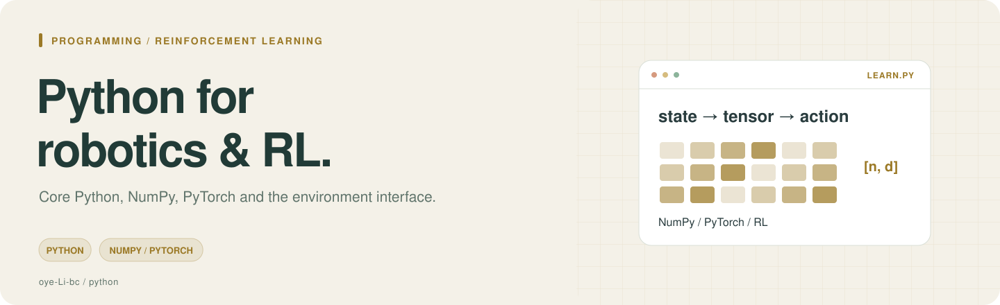
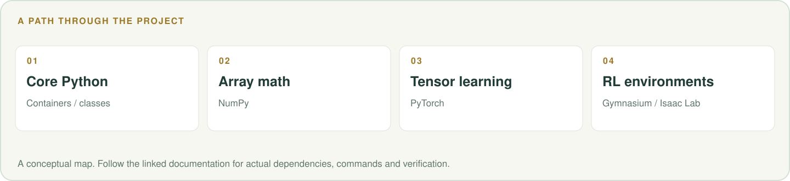

# Python for Robotics & RL

面向机器人与强化学习的 Python 学习笔记，从语法和数据结构过渡到 NumPy、PyTorch、Gymnasium 与 Isaac Lab 代码风格。

**[章节目录](#chapters) · [阅读建议](#reading) · [相关项目](#related)**

<picture>
  <source media="(max-width: 600px)" srcset=".github/readme/workflow-mobile.svg">
  
</picture>

## 章节目录

| 顺序 | 内容 |
|---|---|
| 00 | [总览 · 思维导图](00_%E6%80%BB%E8%A7%88_%E6%80%9D%E7%BB%B4%E5%AF%BC%E5%9B%BE.md) |
| 01 | [语法基础](01_%E8%AF%AD%E6%B3%95%E5%9F%BA%E7%A1%80.md) |
| 02 | [数据结构](02_%E6%95%B0%E6%8D%AE%E7%BB%93%E6%9E%84.md) |
| 03 | [函数与类](03_%E5%87%BD%E6%95%B0%E4%B8%8E%E7%B1%BB.md) |
| 04 | [NumPy](04_NumPy.md) |
| 05 | [PyTorch基础](05_PyTorch%E5%9F%BA%E7%A1%80.md) |
| 06 | [Gymnasium接口](06_Gymnasium%E6%8E%A5%E5%8F%A3.md) |
| 07 | [Isaac · Lab风格](07_Isaac_Lab%E9%A3%8E%E6%A0%BC.md) |
| 08 | [实战例子](08_%E5%AE%9E%E6%88%98%E4%BE%8B%E5%AD%90.md) |
| 09 | [术语速查表](09_%E6%9C%AF%E8%AF%AD%E9%80%9F%E6%9F%A5%E8%A1%A8.md) |

另有[5 天练习清单](%E7%BB%83%E4%B9%A0%E6%B8%85%E5%8D%95_5%E5%A4%A9.md)，可配合章节完成小练习。

## 阅读建议

已有 C/C++ 基础时可先快速阅读前 3 章，再重点练习 NumPy、Tensor 与环境接口。

这是以 Markdown 为主的学习资料仓库，阅读本身无需安装依赖。章节中的示例可单独练习，
具体工具、软件版本和硬件条件应按对应章节核对。

## 相关项目

- [AI 概念入门地图](https://github.com/oye-Li-bc/AI_simple_learning)
- [研究工作流 Skills](https://github.com/oye-Li-bc/research-workflow-skills)
- [个人作品集](https://oye-li-bc.github.io/)

封面与路线图均为可编辑 SVG；[图片说明](.github/readme/README.md)。
